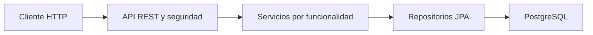

# Artepax


Artepax es un backend académico para gestionar eventos e inventario. Al organizar eventos, una empresa necesita saber si puede comprometer productos para una fecha y cuánto queda por cobrar antes de cerrar el servicio. Artepax vincula la cotización, la reserva de inventario, los pagos y los documentos dentro del mismo flujo.

| Área | Funcionalidades |
| --- | --- |
| Acceso y clientes | Inicio de sesión local y con Google, emisión de JWT, administración de usuarios y gestión de clientes |
| Eventos | Cotización, programación, montaje, cancelación y cierre, con cronogramas y asignación de usuarios |
| Inventario | Productos, decoraciones, reservas de stock, entradas, salidas y ajustes |
| Administración | Pagos, gastos, consultas de rentabilidad, documentos PDF, notificaciones, configuración y auditoría |

Java 21 · Spring Boot 3.5.14 · Maven Wrapper · PostgreSQL · Spring Data JPA · Spring Security · JJWT 0.11.5 · Springdoc 2.8.8 · OpenPDF 3.0.3

## Arquitectura

Una aplicación Spring Boot organiza la API REST por funcionalidad. Los servicios coordinan reglas de negocio y transacciones, y los repositorios acceden a PostgreSQL.



- **Reservas y consumo.** Programar un evento compromete unidades disponibles. Finalizarlo descuenta las unidades reservadas y registra movimientos. Confirmar una cancelación libera las reservas activas.
- **Concurrencia.** La reserva bloquea los productos en orden de ID y calcula el saldo disponible antes de guardar las cantidades comprometidas.
- **Eventos y pagos.** Al confirmar un pago, el servicio guarda el cambio de estado dentro de la transacción y sincroniza la escritura antes de consultar la vista de saldos. Alcanzar el anticipo puede confirmar un evento programado. Liquidar el saldo puede cerrar un evento pendiente de cobro.
- **Documentos.** El backend genera PDF y registra el estado del envío. Si falla el correo en el flujo de generación, el documento queda registrado para reintentar el envío.

## Autenticación y autorización

La API ofrece inicio de sesión local con correo y contraseña y acceso mediante un ID token de Google. Ambos flujos emiten un JWT que el cliente envía como Bearer token. Las operaciones administrativas exigen el rol `ADMIN`. La consulta de identidad `GET /api/usuarios/me` requiere autenticación.

## Estructura del repositorio

| Ruta | Contenido |
| --- | --- |
| [src/main/java](src/main/java) | API REST, servicios, seguridad y persistencia, organizados por funcionalidad |
| [src/test/java](src/test/java) | Pruebas unitarias, de contexto y de integración |
| [docs](docs) | Guías de arquitectura, configuración, reglas, API y pruebas |
| [openspec](openspec) | Especificaciones y registros históricos de cambios |

## Ejecución local

La demo utiliza Docker Compose con Java 21, PostgreSQL 18 y Mailpit. Configura `.env` a partir de la plantilla y ejecuta:

```sh
docker compose up --build --wait --wait-timeout 240
```

Sigue la [guía de configuración](docs/setup.md) para generar las claves locales y [crear el primer administrador](database/README.md). Una vez iniciado el backend, abre [Swagger UI](http://localhost:8080/swagger-ui/index.html). Las cuentas y los PDF se conservan en volúmenes locales.

## Validación de la demo

GitHub Actions verificó la restauración de PostgreSQL desde un volumen vacío, el arranque con Hibernate y el flujo de API desde el login local hasta la confirmación de un pago. Pasaron 257 pruebas de la suite Maven y una prueba de concurrencia con Testcontainers. [Ver ejecución de referencia](https://github.com/LuisS-byte/Artepax/actions/runs/45329625551).

## Documentación

- [Arquitectura y módulos](docs/architecture.md)
- [Configuración local](docs/setup.md)
- [Reglas de negocio](docs/business-rules.md)
- [API REST y autenticación](docs/api.md)
- [Pruebas](docs/testing.md)
- [Modelo PostgreSQL](docs/database.md)
- [Operación y despliegue](docs/deployment.md)

## Estado y contribuciones

El alcance de este repositorio es el backend. La inicialización de PostgreSQL se aplica en un volumen vacío. Mailpit captura el correo de la demo en un buzón local de desarrollo. El login con Google y el envío SMTP real quedan fuera de la validación de la demo.

Artepax es un proyecto académico desarrollado en equipo. El historial de Git registra las [contribuciones al repositorio](https://github.com/LuisS-byte/Artepax/graphs/contributors).
