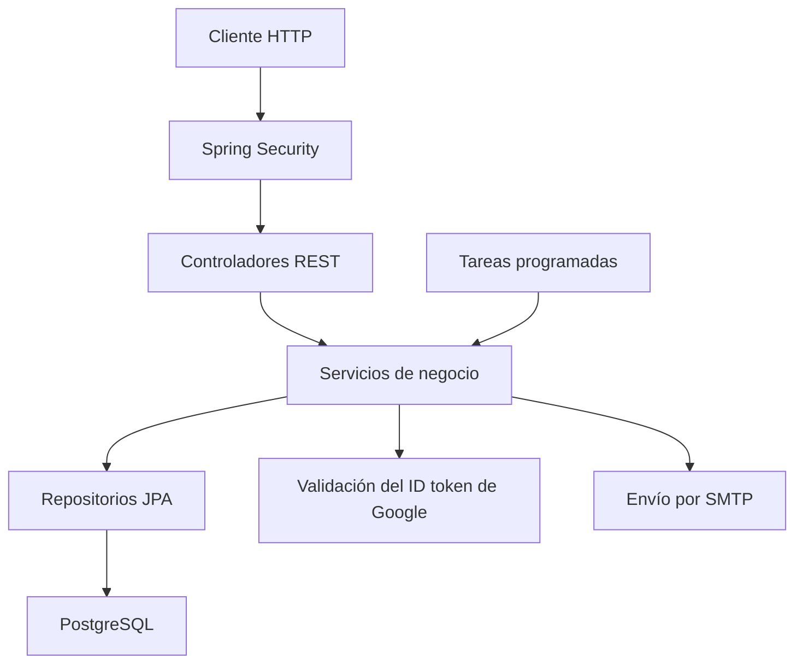
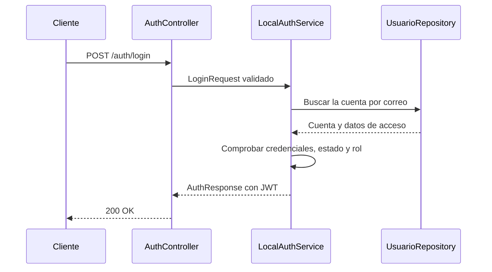

# Arquitectura

Artepax es una aplicación Spring Boot de un solo módulo Maven, organizada por funcionalidad. Los controladores REST reciben DTO y delegan en servicios que coordinan las reglas de negocio. Los repositorios JPA operan sobre entidades, tablas y vistas PostgreSQL. La organización interna de los paquetes varía según el módulo.

| Paquete bajo `com.catolica.Artepax` | Responsabilidad |
| --- | --- |
| `authentication` | Login local, Google ID token, JWT, usuarios y roles |
| `clientes` | Registro de clientes y consulta de sus eventos |
| `evento` | Ciclo de vida, tipos de evento, gastos y rentabilidad |
| `cronograma` | Actividades por evento y asignaciones |
| `inventario` | Productos, decoraciones, disponibilidad y movimientos |
| `pago` | Registro y confirmación de pagos, resúmenes y catálogos |
| `documento` | Generación de PDF, plantillas, descarga y reenvío |
| `comunicacion` | Servicios y configuración para envío de correo |
| `notificacion` | Notificaciones y marcado de lectura |
| `common` | Configuración, errores, auditoría y tareas programadas |

## Ejemplo de flujo de autenticación local

En solicitudes posteriores, el filtro JWT establece la identidad de la petición y Spring Security aplica las restricciones por rol. `GlobalExceptionHandler` transforma excepciones de dominio derivadas de `ArtepaxException` y otros errores de aplicación en respuestas HTTP. Los fallos que ocurren en la cadena de seguridad pueden seguir su propio manejo.

`AuditoriaAspect` intercepta operaciones seleccionadas de clientes, eventos y pagos. `ConfiguracionService` consulta parámetros de base de datos mediante accesores tipados y mantiene un caché en memoria. Las tareas de `common/job` usan parámetros operativos para plazos y recordatorios.

Los flujos dependen de catálogos y vistas PostgreSQL. Los documentos usan almacenamiento en disco y el envío de correo depende de una configuración SMTP operativa. Consulta [configuración local](setup.md) y [reglas de negocio](business-rules.md).
