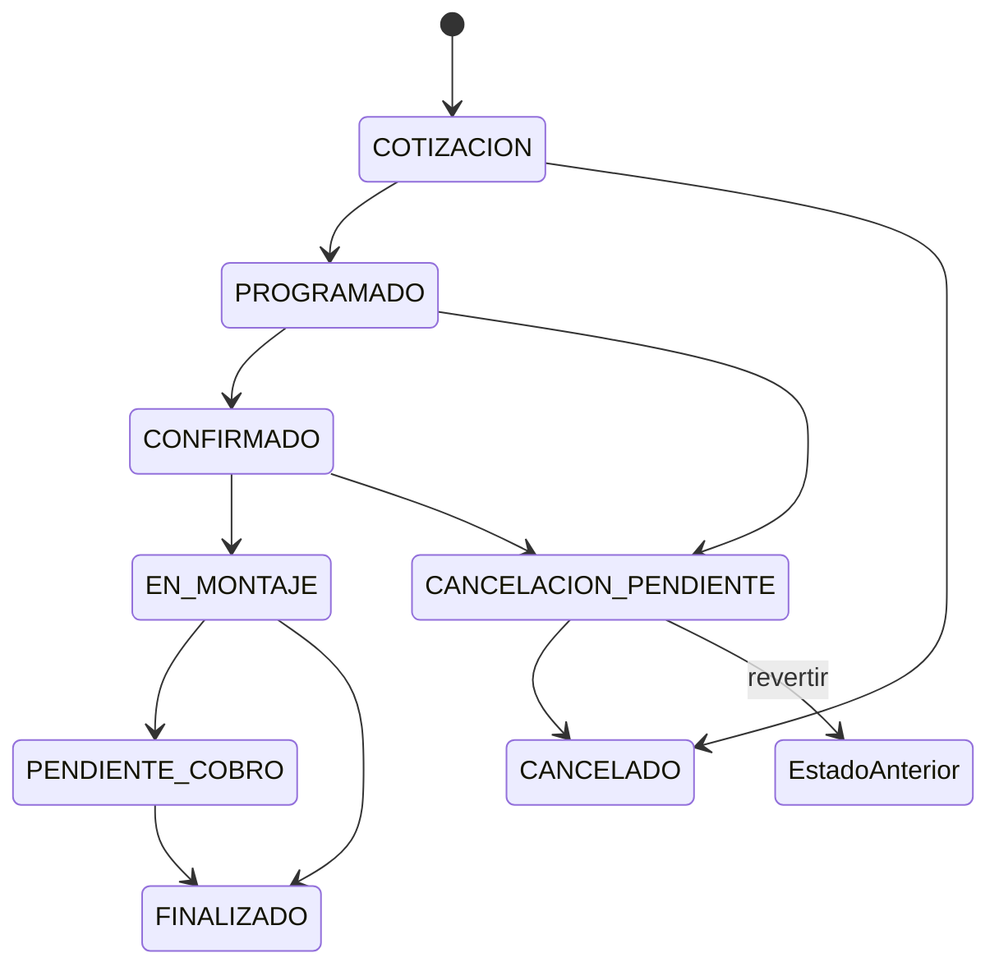

# Reglas de negocio

Las reglas siguientes describen los servicios en la versión revisada. Los flujos requieren los estados y catálogos correspondientes en PostgreSQL.

## Eventos

`EventoServiceImpl` coordina el ciclo de vida. El evento comienza en cotización. Programarlo reserva los productos requeridos. Después de confirmarlo puede iniciarse el montaje. Iniciar una cancelación exige informar el motivo. Finalizar el montaje consume las reservas y deriva al estado de cobro pendiente si queda saldo, o a finalizado si está liquidado.

El diagrama resume las transiciones principales. `EstadoAnterior` representa el estado operativo guardado por el servicio. La cancelación de una cotización puede ser inmediata. Para una cancelación pendiente, el servicio conserva el estado anterior y aplica la confirmación manual o el procesamiento automático al vencimiento del plazo. Revertir restaura el estado guardado.

## Inventario y concurrencia

`EventoStockHandler` crea reservas activas al programar el evento y puede agregar reservas para productos extra. La disponibilidad se calcula como cantidad total menos la suma de las reservas activas. Por ejemplo, si hay 20 unidades y 7 reservadas, quedan 13 disponibles. El total físico sigue en 20 hasta el consumo. La reserva ordena IDs y emplea bloqueo pesimista para reducir conflictos al validar stock concurrentemente.

Al finalizar, se descuenta el stock, se registra el movimiento de salida y se marca cada reserva como `CONSUMIDA`. Confirmar la cancelación marca reservas activas como `LIBERADA`. Las consultas de stock también usan la vista `vista_stock_producto`.

## Pagos y devoluciones

`PagoServiceImpl` registra pagos pendientes y los confirma como pagados. Antes de consultar `vista_pagos_evento`, ejecuta `flush()` para que la vista observe los cambios pendientes de escritura dentro de la transacción. Al alcanzar el anticipo requerido, el servicio puede confirmar un evento programado. Al liquidar el saldo, puede finalizar un evento en cobro pendiente.

`PagoCancelacionHandler` pasa los pagos pagados a devolución pendiente y cancela los pagos pendientes. La devolución requiere gestión administrativa. Los estados de pago y del evento se almacenan y evalúan por separado.

## Documentos, configuración y auditoría

- `DocumentoServiceImpl` genera PDF y guarda el registro del documento. Si falla el envío en el flujo de generación, registra el estado `FALLIDO` y permite reintentar mediante el endpoint de reenvío.
- `ConfiguracionService` consulta la tabla `configuracion`, usa un caché local en memoria y expone invalidación por clave. Las tareas programadas atienden recordatorios, cotizaciones vencidas, saldos pendientes y cancelaciones.
- `AuditoriaAspect` registra operaciones seleccionadas de `EventoServiceImpl`, `PagoServiceImpl` y `ClienteServiceImpl`. El alcance depende de los pointcuts definidos y los errores del aspecto se registran en los logs.
