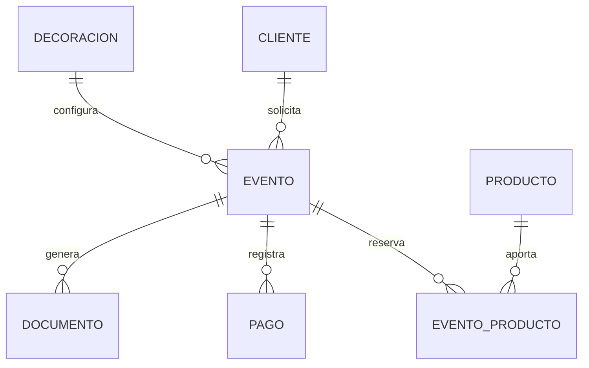

# Modelo PostgreSQL

El script de [inicialización](../database/init.sql) define tablas, restricciones, secuencias y cinco vistas de consulta. El diagrama resume las relaciones utilizadas por el flujo de eventos.

| Grupo | Datos iniciales |
| --- | --- |
| Operación | Roles, tipos de evento, estados de evento y reserva |
| Pagos | Conceptos, métodos y estados |
| Inventario | Productos, decoraciones y asociaciones |
| Comunicación | Plantillas, estados y tipos de notificación |
| Configuración | Anticipo, plazos, mínimos, recordatorios y contacto ficticio |

`vista_stock_producto` y `vista_pagos_evento` respaldan las consultas de disponibilidad y saldos. Las demás vistas cubren cotizaciones vencidas, eventos por período y rentabilidad. El bootstrap crea una cuenta local mediante el rol `ADMIN`. El login Google valida un ID token y busca una cuenta autorizada existente. La demo mantiene `usu_password NOT NULL` y queda centrada en el login local.
