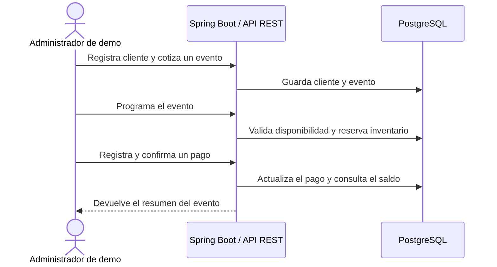

# Artepax: demo local de eventos e inventario

**Guía de 3 a 5 minutos una vez iniciado el servicio.** Artepax es un backend académico desarrollado en equipo. Permite pasar de una cotización a un evento programado con inventario reservado y registrar los pagos del cliente. Esta demo utiliza una base local y datos ficticios; no es una aplicación alojada.

- [Repositorio del equipo](https://github.com/LuisS-byte/Artepax)
- [Contribución de ErnestoT04 al cronograma de montaje y desmontaje (PR #5)](https://github.com/LuisS-byte/Artepax/pull/5)
- [Configuración local](https://github.com/LuisS-byte/Artepax/blob/main/docs/setup.md) · [API y autenticación](https://github.com/LuisS-byte/Artepax/blob/main/docs/api.md) · [Pruebas](https://github.com/LuisS-byte/Artepax/blob/main/docs/testing.md)



## 1. Preparar una instancia aislada

Se necesita Docker con Compose v2 y Python 3 para crear el administrador local. Usa una copia nueva del repositorio, sin otros volúmenes ni instalaciones de Artepax. En Linux o macOS:

```sh
git clone https://github.com/LuisS-byte/Artepax.git artepax-demo-portafolio
cd artepax-demo-portafolio
cp -n .env.example .env
```

Completa `DB_PASS` y `JWT_SECRET` en `.env` con valores diferentes, generados para esta instancia. La [guía oficial del proyecto](https://github.com/LuisS-byte/Artepax/blob/main/docs/setup.md) incluye opciones con OpenSSL o Python y los comandos equivalentes para PowerShell. No uses credenciales reales ni pegues el contenido de `.env` en capturas o mensajes.

```sh
docker compose config --quiet
docker compose up --build --wait --wait-timeout 240
python3 -m venv .venv
.venv/bin/python -m pip install bcrypt==4.3.0
.venv/bin/python database/bootstrap_admin.py
```

Para el asistente, usa un correo ficticio como `admin@example.invalid` y una contraseña privada de 12 a 72 bytes. Abre [Swagger UI](http://localhost:8080/swagger-ui/index.html). Si cambiaste `APP_PORT`, actualiza el puerto de la URL. Ejecuta en tu equipo; no expongas públicamente el servicio ni Mailpit.

## 2. Recorrer el flujo con Swagger

| Paso | Operación | Qué comprobar |
|---|---|---|
| 1. Acceso local | `POST /auth/login` con la cuenta de demo; luego `GET /api/usuarios/me` | Guarda el JWT temporalmente. En las rutas protegidas usa **Authorize** si está disponible o la cabecera `Authorization: Bearer <TOKEN>` en un cliente HTTP. |
| 2. Alta de cliente | `POST /api/clientes` | Usa un correo ficticio que no se haya usado y guarda el `id` del cliente. |
| 3. Cotización | `POST /api/eventos` | Guarda el `id` del evento. Elige una fecha futura (por ejemplo, dentro de 30 días) y usa los IDs apropiados de `GET /api/decoraciones` y `GET /api/tipos-evento`. |
| 4. Reserva | `PATCH /api/eventos/{id}/programar`; consulta `GET /api/eventos/{id}/productos` | Programar compromete unidades disponibles. No equivale a descontarlas del inventario físico. El smoke de CI comprueba por SQL que se cree al menos una reserva activa. |
| 5. Pago | `POST /api/pagos` → `PATCH /api/pagos/{id}/confirmar` → `GET /api/pagos/evento/{eventoId}/resumen` | El primer ID en la confirmación es el del **pago**, no el del evento. Confirmar un abono demuestra el flujo de pagos; no implica que el evento quede cerrado ni que alcance el anticipo. |

Clientes: ejemplo de cuerpo.

```json
{
  "nombre": "Cliente de prueba",
  "telefono": "0000-0000",
  "correo": "cliente-demo-01@example.invalid",
  "direccion": "Dirección ficticia"
}
```

Eventos: esquema de ejemplo con IDs de los catálogos iniciales, tal como los usa el smoke. Sustituye `clienteId` por el ID recién obtenido y elige una fecha futura al ejecutar.

```json
{
  "clienteId": 1,
  "decoracionId": 1,
  "tipoEventoId": 1,
  "fecha": "2027-01-15",
  "horaInicio": "10:00",
  "horaFin": "12:00",
  "ubicacion": "Ubicación ficticia"
}
```

Pagos: ejemplo del conjunto inicial de demo. Sustituye `eventoId` por el ID devuelto en la cotización.

```json
{
  "eventoId": 1,
  "monto": 1,
  "metodoPagoId": 1,
  "conceptoPagoId": 1
}
```

### Extensión opcional: explorar el cronograma

Abre el [PR #5](https://github.com/LuisS-byte/Artepax/pull/5/files): muestra el controlador, los DTO, el servicio y la persistencia del módulo de cronogramas. Durante la demo, puedes explicar cómo se vincula una actividad con un evento, qué validaciones corresponden al servicio y cómo se consulta la programación. La API actual documenta `POST /api/cronogramas` y `GET /api/cronogramas/evento/{idEvento}`. Esta extensión **no** forma parte del smoke automático de pagos y reservas.

## 3. Evidencias para el portafolio

Publicar solo después de ejecutar y comprobar la demo. La guía no incluye capturas.

1. **Swagger y mapa del flujo:** captura las operaciones de eventos y pagos sin desplegar el formulario de login ni mostrar cabeceras. Pie: “API REST del backend local”.
2. **Evento con productos reservados:** captura solo la respuesta del evento o productos y, si hace falta, una consulta local que confirme el estado de la reserva. Pie: “Datos ficticios; programar reserva unidades, no las consume”.
3. **Resumen de pago o cronograma:** muestra el resultado con cliente ficticio. No muestres JWT, claves, credenciales, correos reales, historiales del navegador ni una consola con variables de entorno. Si vas a usar la captura de cronograma, ejecuta y comprueba ese flujo por separado.
4. **Comprobación en CI:** enlaza la [ejecución de CI en `main`](https://github.com/LuisS-byte/Artepax/actions/runs/45330282221), en lugar de usar una captura de un estado antiguo. La ejecución incluye los trabajos `maven` y `compose`; la [referencia documentada](https://github.com/LuisS-byte/Artepax/actions/runs/45329625551) reporta 257 casos Maven y una prueba de concurrencia con Testcontainers. No acredita login real de Google, SMTP real ni despliegue público.

Al terminar desde la carpeta de la demo, `docker compose down` detiene sus servicios. Conserva los volúmenes locales y no uses comandos de eliminación global.
